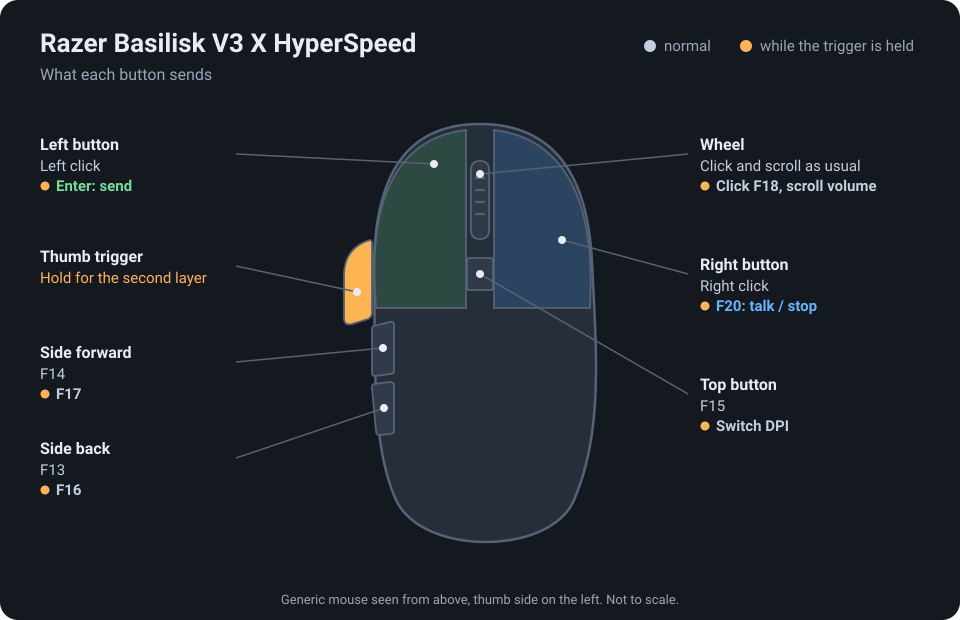
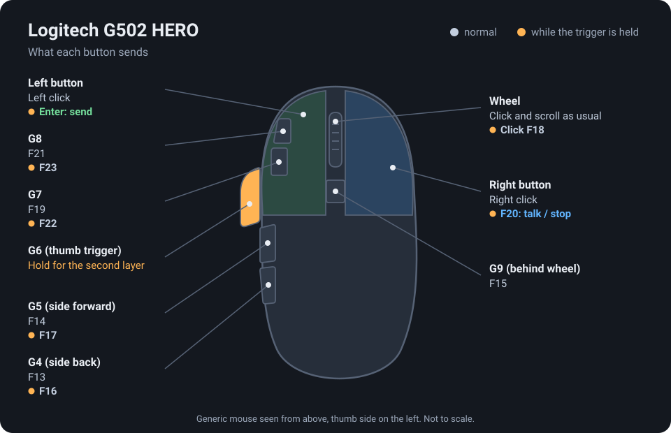

# talk-mouse

Mouse buttons for working by voice. Hold the thumb trigger and right click to talk, speak, stop, then trigger + left click presses Enter. You can brief an agent, send it, and do it again without touching the keyboard.

The other buttons send F13–F19 and F21–F23, keys that ordinary keyboards don't have. They're free for whatever you like: push-to-talk, switching windows, editor commands, macros.

## The buttons

| Hold the trigger and… | It sends | For |
|---|---|---|
| **right click** | F20 | start or stop dictation |
| **left click** | Enter | send |

Normal left and right clicks don't change. F20 is bound to your dictation app on the computer, and any speech-to-text tool you can toggle with a key or command will do.

The same position sends the same key on both mice, so a shortcut works whichever one you're holding.

## Set it up (Linux)

You need Python 3.11+. The tester also needs `python-evdev`.

1. **Allow access:** copy [`setup/70-talk-mouse.rules`](setup/70-talk-mouse.rules) to `/etc/udev/rules.d/` and replug the mouse.
2. **Look first:** `./talk-mouse show razer` (or `g502`) only reads.
3. **Save it on the mouse:** `./talk-mouse apply razer`. Add `-n` to see what would change. A backup is saved first, and every setting is read back.
4. **Connect dictation:** bind F20 to your speech-to-text toggle. For Hyprland, see [`setup/hyprland.lua`](setup/hyprland.lua).
5. **Check it:** `./talk-mouse test razer` ticks off each button as you press it.

To undo: `./talk-mouse restore ~/.local/state/talk-mouse/<backup>.json`.

Linux keyboard layouts often rename F13–F18 and F20–F23; F20 may even be "mic mute". The XKB option `fkeys:basic_13-24` turns them back into plain function keys. A few programs ignore keys above F12 altogether.

## Change it

Edit [`keymap.toml`](keymap.toml), then run `./talk-mouse apply <mouse>` and `tools/draw.py` to redraw the pictures. Buttons you don't list are left alone.

## What's supported

| Mouse | USB ID | Trigger layer |
|---|---|---|
| Razer Basilisk V3 X HyperSpeed (USB receiver) | `1532:00b9` | Hypershift, must be set on the thumb trigger (it was on ours) |
| Logitech G502 HERO | `046d:c08b` | G-Shift on G6, written to the profile in use |

The tool refuses other models. Writing a mouse's memory always carries some risk, so keep the backup.

**Checked so far:** every setting reads back correctly on both mice, and the Razer's survived being switched off. On the Razer, F13 and F14 have been seen arriving. The trigger combinations and the G502's buttons still need a hands-on test, and the udev rules haven't been tried on a fresh machine.

## Credits

The mouse protocols were worked out by others: [razer-control](https://github.com/voidrlm/razer-control) (crediting OpenSnek), OpenRazer [#2845](https://github.com/openrazer/openrazer/issues/2845) and [#2962](https://github.com/openrazer/openrazer/pull/2962), and [libratbag](https://github.com/libratbag/libratbag). The code here is a separate implementation.

MIT licensed. Not affiliated with Razer or Logitech.
